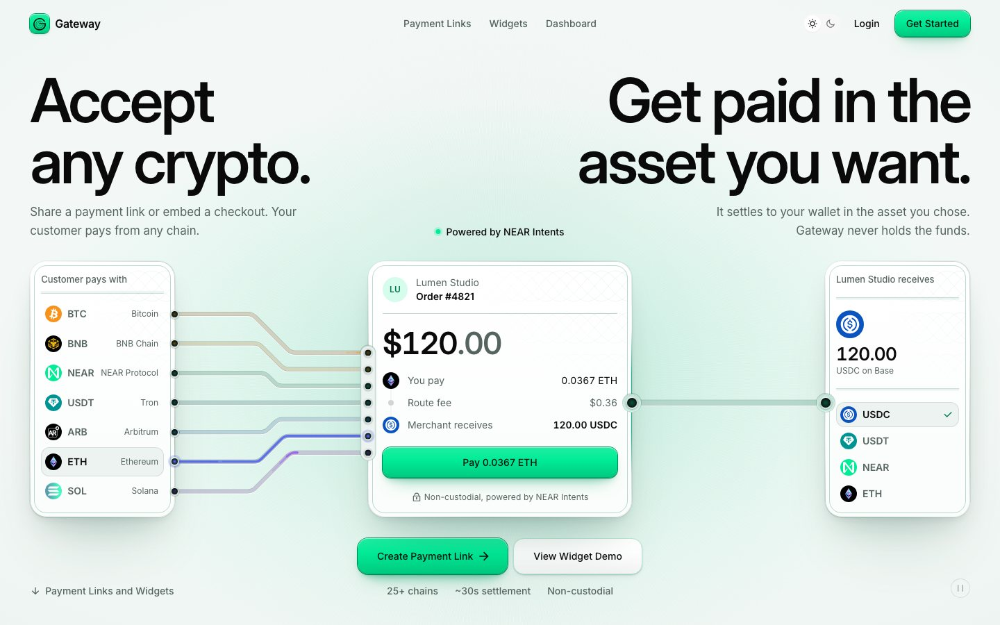
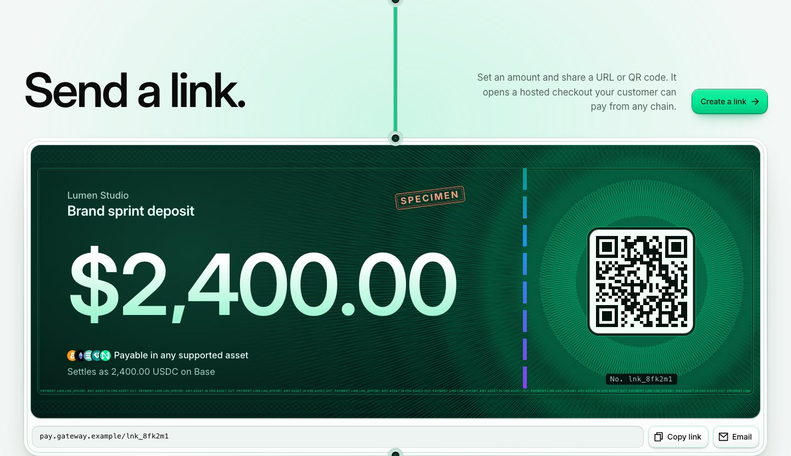
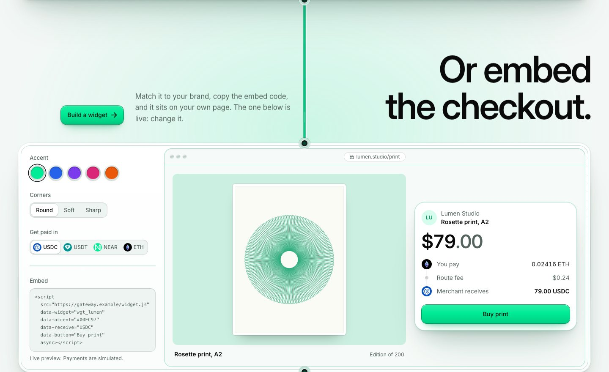
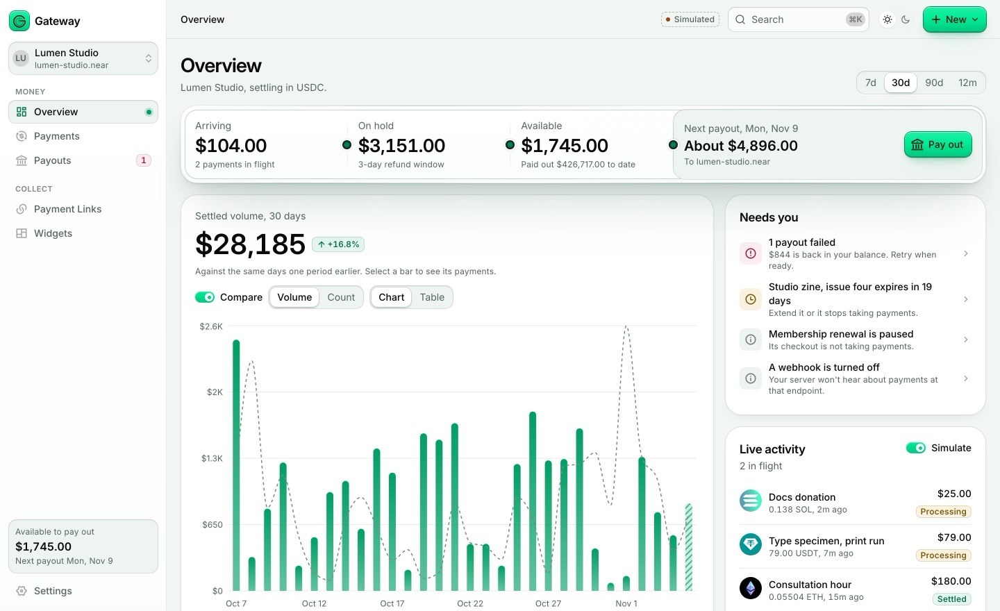
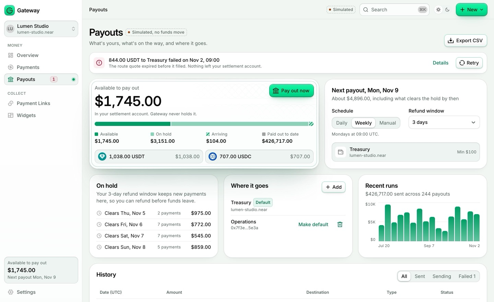
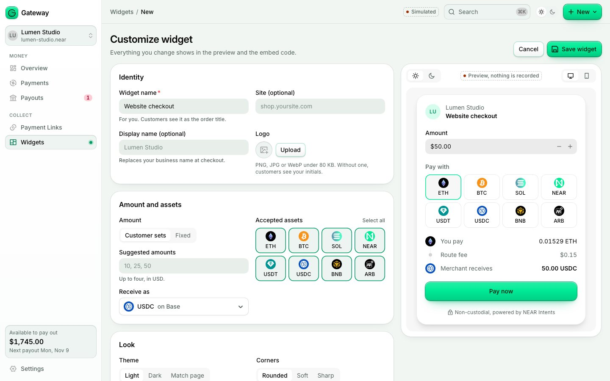
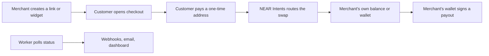

<div align="center">

# Gateway

**Accept any crypto. Get paid in the asset you want.**

Payment links, an embeddable checkout and a merchant dashboard, with settlement meant to be routed by NEAR Intents.


<picture>
  <source media="(prefers-color-scheme: dark)" srcset=".github/assets/landing-dark.jpg">
  
</picture>

</div>

> [!IMPORTANT]
> **Runs in test mode until a person switches on real money.** Test mode runs the whole system, with a simulated route in place of NEAR Intents, so no funds move. Going live needs a NEAR partner key, an exact acknowledgement phrase and a small test with your own funds: see [docs/runbooks/going-live.md](./docs/runbooks/going-live.md). Bitcoin stays closed with real money for now.

## The idea

A merchant creates a payment link or drops a checkout widget on their site. The customer pays with whichever asset they hold, on whichever chain. The merchant receives the asset they chose. [NEAR Intents](https://docs.near-intents.org) routes the swap, and Gateway never holds the funds or the keys.

## Visual tour

### Landing: pick an asset, watch the route light up

The hero above is interactive: choose what the customer pays with and what the merchant receives, and the channels between them light up. It uses illustrative prices and moves no funds.

### Payment links: a link drawn as a cheque

<picture>
  <source media="(prefers-color-scheme: dark)" srcset=".github/assets/cheque-dark.jpg">
  
</picture>

### Embeddable widget, live on the page

<picture>
  <source media="(prefers-color-scheme: dark)" srcset=".github/assets/console-dark.jpg">
  
</picture>

### Dashboard overview

Range control, settled volume with a prior-period comparison, a payout position strip, a "needs you" queue and a live feed.

<picture>
  <source media="(prefers-color-scheme: dark)" srcset=".github/assets/overview-dark.jpg">
  
</picture>

### Payouts

Balance read from chain and split into available, on hold and arriving, with reminders, destinations and a run history. Your wallet signs every payout.

<picture>
  <source media="(prefers-color-scheme: dark)" srcset=".github/assets/payouts-dark.jpg">
  
</picture>

### Widget builder

Identity, accepted assets, look and behaviour on the left, a live preview and copyable embed snippet on the right.

<picture>
  <source media="(prefers-color-scheme: dark)" srcset=".github/assets/widget-builder-dark.jpg">
  
</picture>

## Features

- **Payment links**: a USD amount or customer-set, receive asset, expiry and success URL. Each opens at `/pay/<id>` for anyone, with a QR code.
- **Hosted checkout**: the customer picks an asset, sees the real price and route fee, gets a one-time deposit address, and pays by QR, copy or browser wallet. A reload resumes the same address. Underpayments and returned deposits are explained.
- **Embeddable widget**: `<script src=".../widget.js" data-widget="wgt_..." async>`, or `@gateway/react`. Settings live in the dashboard, so edits apply everywhere it's embedded.
- **Non-custodial settlement**: payments settle to the merchant's own NEAR Intents balance or straight to their wallet. Only their key can move them. Changing the wallet needs signatures from both the old and the new one.
- **Payouts and refunds**: signed by the merchant's wallet, with partial refunds to the customer's original chain and asset. The browser checks NEAR's signature before asking the wallet to sign.
- **Merchant dashboard**: metrics, payments with a real timeline, payouts, monthly statements, link and widget details, notifications, a command palette and keyboard shortcuts (press `?`).
- **Developers**: a REST API with idempotency keys, signed webhooks with retries and a delivery log. See `/docs`.
- **Teams**: email sign-in, invitations and four roles, with an audit log.
- **Operators**: off switches per chain and asset, wallet screening against sanctions lists, health checks and runbooks.

## How it works



The merchant keeps the keys, and NEAR Intents moves the money. Gateway quotes, tracks and reports. Quotes are checked before anyone sees them: the provider's signature, what was quoted against what was asked, route minimums, off switches, sanctions lists and price freshness.

## What Gateway depends on

Using NEAR Intents means carrying its risks: a pause, an exploit or a compliance hold can delay funds in a balance. Straight-to-wallet settlement avoids holding a balance there. Merchants accept responsibility for their own KYC, AML, licences and regulatory audits in the [Terms](./app/terms/page.tsx).

## Routes

| Route | What it is |
| --- | --- |
| `/` | Landing page with a live checkout demo |
| `/pay/[id]` | Hosted checkout, open to anyone with the link |
| `/dashboard` | Overview: range control, volume, KPIs, payouts, live feed, breakdowns |
| `/dashboard/payments` | Filters, sorting, bulk actions, detail drawer |
| `/dashboard/payouts` | Balance, schedule, destinations, history |
| `/dashboard/links`, `/dashboard/links/[id]` | Manage payment links, and each link's details |
| `/dashboard/links/new`, `/dashboard/links/[id]/edit` | Create or edit a link, preview, share URL and QR |
| `/dashboard/widgets`, `/dashboard/widgets/[id]` | Manage widgets, and each widget's details |
| `/dashboard/widgets/new`, `/dashboard/widgets/[id]/edit` | Customize a widget, preview, embed snippet |
| `/dashboard/statements` | Monthly records and CSV exports |
| `/dashboard/notifications` | Payments, payouts and account changes |
| `/dashboard/settings` | Settlement wallet, branding, webhooks, API keys, team, alerts, audit log |
| `/login`, `/onboarding`, `/invite/[token]` | Sign-in, setup, joining a team |
| `/embed/[id]`, `/widget.js` | The embedded checkout |
| `/docs`, `/terms`, `/privacy`, `/status` | Developer docs, legal drafts, health |

## Tech stack

- [Next.js](https://nextjs.org) 16.4 (App Router, `cacheComponents` enabled), React 19.3, TypeScript and Tailwind CSS v4
- Postgres with Drizzle ORM and committed SQL migrations, and a separate worker process
- `viem` for wallet signatures, `@noble/curves` for verifying quotes, `zod` for every input
- BoardUI: source-owned components copied into `components/`, built on React Aria Components
- Recharts, `qrcode.react`, Motion, Remix Icon, `@web3icons/react`
- Vitest, Playwright, and a mutation script for the money guards

## Quick start

Requires Node.js 22.12 or newer. Postgres comes with it for local work, with no Docker needed.

```bash
git clone https://github.com/obsrvgmi/gateway.git
cd gateway
npm install
cp .env.example .env.local        # set SECRET_KEY: openssl rand -base64 48

npm run dev:db                    # Postgres on :5433, migrated. Leave it running.
npm run dev                       # the app, on :3000
npm run worker                    # status polling, webhooks, email
```

Open <http://localhost:3000> and choose **Get Started**. With `EMAIL_PROVIDER=console`, the sign-in link prints in the terminal. Connect a browser wallet, create a link, and pay it with the test-mode buttons at checkout.

```bash
npm run build         # web, worker, migration and ops bundles
npm start             # the production web server
npm run lint
npm run typecheck     # route types, then tsc
npm test              # unit and integration, on real Postgres
npm run test:e2e      # browser tests. First: NEXT_PUBLIC_TEST_BUILD=true npm run build
npm run test:live     # our guards against the real NEAR API. Sends no funds
npm run test:mutation # deletes each money guard and checks a test fails
```

## Deploying

`Dockerfile` builds one image that runs as web and worker. See [docs/runbooks/operations.md](./docs/runbooks/operations.md) and [docs/runbooks/going-live.md](./docs/runbooks/going-live.md).

## Project structure

```
app/                  Pages and API routes
  api/v1/             The merchant REST API
components/
  checkout/           LiveCheckout (real), CheckoutWidget (previews and landing)
  dashboard/          Shell, sidebar, primitives, charts, views/
  marketing/          Landing page
  base/ application/ foundations/   Vendored BoardUI source
lib/                  Shared by browser and server: assets, money, intent checks, store
server/               Server only
  auth/ http/         Sessions, roles, route wrappers, rate limits
  db/                 Schema and migrations
  payments/           Provider layer, guards, state machine, checkout, payouts, refunds
  webhooks/ email/    Delivery
worker/               Background jobs
packages/react/       @gateway/react
e2e/ test/            Browser, integration and live tests
docs/                 Design and runbooks
```

## Design system

The UI uses BoardUI semantic colour tokens and composite typography utilities rather than raw palette classes, so dark mode works automatically. Merchant-facing widgets can be themed locally (accent, light or dark scope) without leaking into the page. The rules for contributors and coding agents are in [AGENTS.md](./AGENTS.md).

## Before real money

Everything left needs a person: a NEAR partner key and written answers from NEAR, a lawyer's read of the terms, a small test with your own funds, and explicit approval. [The runbook](./docs/runbooks/going-live.md) has the steps. Known limits are at the end of [the design](./docs/superpowers/specs/2026-11-06-production-gateway-design.md).

## Contributing

Read [CLAUDE.md](./CLAUDE.md) first (it covers the architecture and the Next.js 16 caveats) and [AGENTS.md](./AGENTS.md) for UI rules. Work in small branches, and update CLAUDE.md in the same change as any route, data-model or `lib/` change.

## Licence

All rights reserved; see [LICENSE](./LICENSE). The owner may replace this with an open licence.
