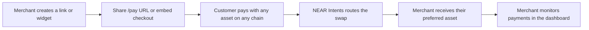

<div align="center">

# Gateway

**Accept any crypto. Get paid in the asset you want.**

Payment links, an embeddable checkout and a merchant dashboard, with settlement meant to be routed by NEAR Intents.


<picture>
  <source media="(prefers-color-scheme: dark)" srcset=".github/assets/landing-dark.jpg">
  
</picture>

</div>

> [!WARNING]
> **Frontend mock, no real payments.** This is a high-fidelity prototype. There is no backend and no blockchain call: wallets, quotes, rates, settlement, auth, payouts and API keys are all simulated in the browser. Do not point real funds at it.

## The idea

A merchant creates a payment link or drops a checkout widget on their site. The customer pays with whichever asset they hold, on whichever chain. The merchant receives the asset they chose. Gateway is meant to route the swap with [NEAR Intents](https://docs.near-intents.org) and never hold the funds.

This repo is the product surface for that idea, built end to end as a clickable prototype: the marketing site, the hosted checkout, the widget builder and the merchant dashboard. Everything behind the surface is simulated, so you can explore the whole flow without a wallet.

## Visual tour

### Landing: pick an asset, watch the route light up

The hero above is interactive: choose what the customer pays with and what the merchant receives, and the channels between them follow a fake three-step settlement timeline.

### Payment links: a link drawn as a cheque

<picture>
  <source media="(prefers-color-scheme: dark)" srcset=".github/assets/cheque-dark.jpg">
  
</picture>

### Embeddable widget, live on the page

<picture>
  <source media="(prefers-color-scheme: dark)" srcset=".github/assets/console-dark.jpg">
  
</picture>

### Dashboard overview

Range control, settled volume with a prior-period comparison, a payout position strip, a "needs you" queue and a simulated live feed.

<picture>
  <source media="(prefers-color-scheme: dark)" srcset=".github/assets/overview-dark.jpg">
  
</picture>

### Payouts

Balance split into available, on hold and arriving, a schedule, destinations and a run history. Simulated: no funds move.

<picture>
  <source media="(prefers-color-scheme: dark)" srcset=".github/assets/payouts-dark.jpg">
  
</picture>

### Widget builder

Identity, accepted assets, look and behaviour on the left, a live preview and copyable embed snippet on the right.

<picture>
  <source media="(prefers-color-scheme: dark)" srcset=".github/assets/widget-builder-dark.jpg">
  
</picture>

## Features

- **Payment links**: title, USD amount (or let the customer choose), receive asset, expiry and success URL. Share the `/pay/<id>` URL or its QR code; links can be edited, paused and deleted.
- **Hosted checkout**: the customer picks one of 8 assets, sees what they pay, the route fee and what the merchant receives, then steps through a simulated confirm, route and settle sequence.
- **Payment collection widget**: theme (light, dark, match page), accent colour, corner radius, amount mode and button label, with live preview and a copyable embed snippet.
- **Merchant dashboard**: overview with 7-day to 12-month ranges and a simulated live feed; a filterable, sortable payments table with bulk actions and a timeline drawer; payouts; link and widget management; settings; a command palette (`Ctrl/Cmd + K`).
- **Demo data**: seeded, deterministic history over two years; changes persist in `localStorage`, and settings can clear or restore it.
- **Light and dark** themes through BoardUI semantic tokens, and a reduced-motion path for the landing animation.

## How it is meant to work



In this repo, steps C to E are a timed UI simulation using fixed mock prices and a flat 0.3% route fee. Steps A, B and F are real UI backed by local browser state.

## What is real and what is simulated

| Area | Status |
| --- | --- |
| Auth | Fake. "Login" and "Get Started" go to `/dashboard`. |
| Payments, quotes, rates | Simulated. Timed UI sequence, static USD prices, no wallet, no chain calls. |
| Data | Seeded plus `localStorage`; one browser only, no server or API. |
| Live activity, payouts | Simulated in-page timers; no funds move. |
| Webhooks, team, email alerts, API keys | Saved or displayed locally; nothing is sent or authenticates. |
| `/widget.js` and `@gateway/react` in the embed snippet | Do not exist; strings only. |
| "Non-custodial" copy | Describes the intended product, not this mock. |

The full table lives in [CLAUDE.md](./CLAUDE.md#mock-vs-real).

## Routes

| Route | What it is |
| --- | --- |
| `/` | Landing page with a live checkout demo |
| `/pay/[id]` | Hosted checkout for a payment link |
| `/dashboard` | Overview: range control, volume, KPIs, payouts, live feed, breakdowns |
| `/dashboard/payments` | Filters, sorting, bulk actions, detail drawer |
| `/dashboard/payouts` | Balance, schedule, destinations, history |
| `/dashboard/links` | Manage payment links |
| `/dashboard/links/new`, `/dashboard/links/[id]/edit` | Create or edit a link, preview, share URL and QR |
| `/dashboard/widgets` | Manage widgets |
| `/dashboard/widgets/new`, `/dashboard/widgets/[id]/edit` | Customize a widget, preview, embed snippet |
| `/dashboard/settings` | Payouts, branding, webhooks, API keys, team, alerts, demo data |

## Tech stack

- [Next.js](https://nextjs.org) 16.4 (App Router, `cacheComponents` enabled) and React 19.3
- TypeScript and Tailwind CSS v4
- BoardUI: source-owned components copied into `components/`, built on React Aria Components
- Recharts, TanStack Table, `qrcode.react`, Motion, Remix Icon, `@web3icons/react`
- Inter via `next/font`

## Quick start

Requires Node.js and npm.

```bash
git clone https://github.com/obsrvgmi/gateway.git
cd gateway
npm install
npm run dev
```

Open <http://localhost:3000>, then try **Get Started** for the dashboard or **Create Payment Link** and pay it from `/pay/<id>`.

```bash
npm run build        # production build
npm run start        # serve the production build
npm run lint         # eslint
npm run typecheck    # route types, then tsc
npm test             # vitest
```

## Project structure

```
app/                  Routes: landing, /pay/[id], /dashboard/*
components/
  checkout/           CheckoutWidget (shared UI) and HostedCheckout
  dashboard/          Shell, sidebar, primitives, charts, views/
  marketing/          Landing hero, flow channels, product section, nav
  brand/              Logo, token logos, guilloche seal
  base/ application/ foundations/   Vendored BoardUI source
lib/                  Types, store, seed data, quotes, metrics, formatting
styles/               BoardUI theme, typography, landing stage styles
hooks/ utils/         BoardUI helpers (cx, etc.)
.github/assets/       README screenshots and social preview
```

State lives in `lib/store.ts` (`useSyncExternalStore` plus `localStorage`). Seed data in `lib/seed.ts` comes from a fixed PRNG and a fixed "now", so server and client render the same thing.

## Design system

The UI uses BoardUI semantic colour tokens and composite typography utilities rather than raw palette classes, so dark mode works automatically. Merchant-facing widgets can be themed locally (accent, light or dark scope) without leaking into the page. The rules for contributors and coding agents are in [AGENTS.md](./AGENTS.md).

## Roadmap: what real integration needs

- [ ] Backend and database for links, widgets, payments and merchants
- [ ] Real authentication in place of the login stub
- [ ] Wallet connection and transaction signing for customers
- [ ] NEAR Intents integration for real quotes, routing and settlement status
- [ ] A published embeddable widget bundle and React package
- [ ] Working API keys and webhooks
- [ ] Security review before handling funds; non-custodial design is a goal, not a property of this mock

## Contributing

Read [CLAUDE.md](./CLAUDE.md) first (it covers the Next.js 16 caveats and the mock-vs-real table) and [AGENTS.md](./AGENTS.md) for UI rules. Work in small branches, and update CLAUDE.md in the same change as any route, data-model or `lib/` change.

## Licence

All rights reserved; see [LICENSE](./LICENSE). The owner may replace this with an open licence.
