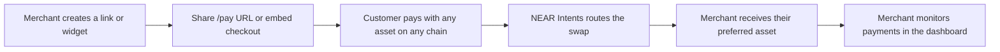

<div align="center">

# Gateway

**Accept any crypto. Get paid in the asset you want.**

Payment links and an embeddable checkout, with settlement routed by NEAR Intents.


</div>

<p align="center"><sub>crypto-payments · payment-gateway · payment-links · checkout-widget · near-intents · nextjs · tailwind-v4 · boardui</sub></p>

> **Frontend mock, no real payments.** This is a high-fidelity prototype. There is no backend and no blockchain call: wallets, quotes, rates, settlement, auth and API keys are all simulated in the browser. Do not point real funds at it.

<!-- screenshots -->

## Features

- **Payment Links**: create a link with a title, USD amount (or let the customer choose), receive asset, expiry and success URL. Share the `/pay/<id>` URL or its QR code.
- **Hosted checkout**: the customer picks any of 8 assets, sees what they pay, the route fee and what the merchant receives, then steps through a simulated confirm, route and settle sequence.
- **Payment Collection Widget**: customize theme (light, dark, match page), accent color, corner radius, amount mode and button label, with a live preview and copyable embed snippet.
- **Merchant dashboard**: an overview with 7-day to 12-month ranges, route and settlement breakdowns and a simulated live feed; a filterable, sortable payments table with bulk actions and a payment timeline; link and widget management with widget editing; settings.
- **Demo data**: seeded, deterministic history; changes persist in `localStorage`; settings can clear or restore it.
- **Light and dark** themes via BoardUI semantic tokens.

## How it is meant to work



In this repo, steps C to E are a timed UI simulation using fixed mock prices; steps A, B and F are real UI backed by local browser state.

## Routes

| Route | What it is |
| --- | --- |
| `/` | Landing page with a live checkout demo |
| `/pay/[id]` | Hosted checkout for a payment link |
| `/dashboard` | Overview: range control, volume, KPIs, payouts, live feed, breakdowns |
| `/dashboard/links` | Manage payment links |
| `/dashboard/links/new` | Create a link, preview, share URL and QR |
| `/dashboard/widgets` | Manage widgets |
| `/dashboard/widgets/new` | Customize a widget, preview, embed snippet |
| `/dashboard/widgets/[id]/edit` | Reopen and edit a saved widget |
| `/dashboard/payments` | Payments: filters, sorting, bulk actions, detail drawer |
| `/dashboard/settings` | Payouts, branding, webhooks, API keys, team, alerts, demo data |

## Tech stack

- [Next.js](https://nextjs.org) 16.4 (App Router, `cacheComponents` enabled) and React 19.3
- TypeScript
- Tailwind CSS v4
- BoardUI: source-owned components copied into `components/` (built on React Aria Components)
- Recharts (charts), TanStack Table (tables), `qrcode.react` (QR codes), Motion, Remix Icon
- Inter via `next/font`

## Getting started

```bash
git clone https://github.com/obsrvgmi/gateway.git
cd gateway
npm install
npm run dev
```

Open <http://localhost:3000>. Other scripts:

```bash
npm run build        # production build
npm run start        # serve the production build
npm run lint         # eslint
npx tsc --noEmit     # typecheck
```

Add a BoardUI component: `npx boardui@latest add <name> --yes`.

## Project structure

```
app/                  Routes: landing, /pay/[id], /dashboard/*
components/
  checkout/           CheckoutWidget (shared UI) and HostedCheckout
  dashboard/          Shell, sidebar, shared primitives, views/
  marketing/          Landing hero, flow channels, product section, nav
  brand/              Logo, token logos, guilloche seal
  base/ application/ foundations/   Vendored BoardUI source
lib/                  Types, store, seed data, quotes, metrics, formatting
styles/               BoardUI theme, typography, light theme scope
hooks/ utils/         BoardUI helpers (cx, etc.)
```

State lives in `lib/store.ts` (`useSyncExternalStore` plus `localStorage`, key `gateway:demo-state:v1`). Seed data in `lib/seed.ts` is generated from a fixed PRNG and a fixed "now", so server and client render the same thing. See [CLAUDE.md](./CLAUDE.md) for details.

## Design system

The UI uses BoardUI semantic color tokens and composite typography utilities rather than raw palette classes, so dark mode works automatically. Merchant-facing widgets can be themed locally (accent, light or dark scope) without leaking into the page. The rules agents and contributors follow are in [AGENTS.md](./AGENTS.md).

## Roadmap: what real integration needs

- [ ] Backend and database for links, widgets, payments and merchants
- [ ] Real authentication in place of the login stub
- [ ] Wallet connection and transaction signing for customers
- [ ] NEAR Intents integration for real quotes, routing and settlement status
- [ ] A published embeddable widget bundle and React package (the embed snippet currently points at files that do not exist)
- [ ] Working API keys and webhooks
- [ ] Security review before handling funds; non-custodial design is a goal, not a property of this mock

## Contributing

Read [CLAUDE.md](./CLAUDE.md) first (it also covers the Next.js 16 caveats and the mock-vs-real table), and [AGENTS.md](./AGENTS.md) for UI rules. Work in small branches, and update CLAUDE.md in the same change as any route, data-model or `lib/` change.
