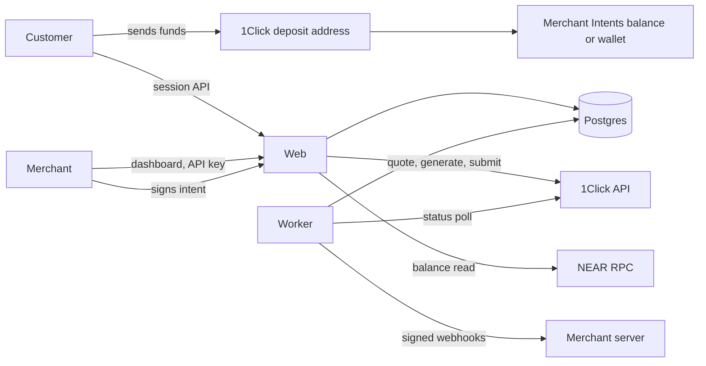

# Gateway production design

Date: 2026-11-06. Status: decisions delegated to the implementer by the project lead ("rest things manage by your own"), except where marked as needing a human.

## Goal

Turn the frontend mock into a real, non-custodial crypto payment gateway: real accounts, real data, real NEAR Intents payments, payouts and refunds, a real widget and API, and every feature the UI shows. Real money is possible but switched off until a person explicitly approves it.

## Decisions

| # | Decision | Why |
| --- | --- | --- |
| 1 | Default settlement goes to the **merchant's own NEAR Intents balance** (`recipientType: INTENTS`, recipient = the merchant's lowercase EVM address). Per merchant, **direct-to-wallet** (`DESTINATION_CHAIN`) is the alternative. | Keeps balances, payouts, swaps and refunds. Gateway holds no keys and ships no contract to audit. |
| 2 | Gateway never holds a merchant key. Every balance payout and refund is signed by the merchant's wallet. Scheduled payouts become scheduled prompts. | Each key on an Intents account has full control and no limited key type is documented, so a Gateway-held key would be custody. |
| 3 | Merchants accept responsibility for their own KYC, AML, licences and regulatory audits in the Merchant Terms, with a stored, versioned acceptance. There is no licensing gate in the product. | Lead's decision. Needs a lawyer's read before real merchants; see Human items. |
| 4 | Gateway still screens wallets against sanctions lists, keeps an audit log and shows disclosures. | 1Click terms 4.1(f), (g), (i), (j) and 4.4 bind the developer whatever our merchant terms say; losing the API ends the product. |
| 5 | Product copy says "non-custodial", never "decentralized". | Gateway runs servers and an API key. Only non-custody is provable. |
| 6 | Payments run in `sim` mode unless every live gate passes (see Live gates). Sim mode uses the same pipeline with a simulated provider. | Real tests spend real money, and the docs show no sandbox. |
| 7 | The merchant API exposes payments, links and webhooks, never a quote pass-through. | Terms 4.1(a) bars exposing 1Click as a "standalone API service, proxy, wrapper, or gateway". |
| 8 | Keep the existing views. Rewire `lib/store.ts` to the server behind the same `useGateway()` and `actions` surface. Money actions are not optimistic. | Least churn; the UI is the part that already works. |

Option rejected: Gateway-held funds (a key theft loses everything, the non-custodial claim goes, payout sweeps may conflict with 4.1(h)). Option deferred: our own vault contracts (largest build, audit needed, EVM only); revisit if merchants demand fully automatic payouts.

## Architecture

- **Web**: Next.js 16 App Router. Route handlers under `app/api`. Proxy (`proxy.ts`) does optimistic redirects only; handlers enforce auth.
- **Worker**: a separate Node process (`worker/index.ts`) for status polling, webhook delivery, email, reconciliation, schedules and list refresh. Jobs are claimed with `FOR UPDATE SKIP LOCKED`, so several workers are safe.
- **Database**: Postgres, Drizzle ORM and committed SQL migrations. Base-unit amounts are `numeric(78,0)`, read as strings and computed with `BigInt`; floats are for display only.
- **Server code** lives in `server/`, each file starting with `import "server-only"` where it may be reached from Next. Client code never imports it.
- **Auth**: passwordless email magic links; opaque session tokens stored hashed; `HttpOnly; Secure; SameSite=Lax` cookies; Origin check on every mutating handler; RBAC (owner, admin, finance, viewer) enforced per handler.
- **Client wallet**: EIP-1193 and EIP-6963 injected wallets with `viem` helpers. No project ID or third-party relay.

## Money flows

### Payment (customer pays)

1. `/pay/[id]` or `/embed/[id]` loads the public source. The customer picks an asset, and the amount if the link lets them.
2. A preview is a `dry` quote. It shows what they pay and the route fee.
3. The customer connects a wallet or enters one. It becomes `refundTo` and satisfies the visible-wallet rule. It is format-checked for that chain and screened.
4. The server inserts the payment row (`quoting`) **before** calling 1Click, keyed by a client idempotency key, then requests a live `EXACT_OUTPUT` quote: the merchant receives the exact amount, and fees raise the deposit.
5. Quote guards run (below). The full quote and signature are stored. The customer sees the address, memo, amount, deadline, and "pay with wallet" on EVM.
6. Optional `POST /v0/deposit/submit` with the tx hash speeds detection.
7. The worker polls `/v0/status` until terminal.

### Payment state machine

`quoting -> awaiting_deposit -> deposit_seen -> processing -> settled`, with `incomplete_deposit`, `provider_refunded`, `failed`, `expired`, and for merchant refunds `settled -> refund_pending -> refunded`.

- `expired` means the deadline passed with no deposit seen. It is **not final**: polling continues (hourly, for 30 days), and any later status moves the payment forward. `PENDING_DEPOSIT` never means "unpaid".
- No flow reissues a deposit address automatically. Starting over is an explicit customer action with an "if you already sent funds, do not send again" warning, and old addresses stay tracked.
- Each transition appends a `payment_events` row and an outbox row in one transaction. Transitions are a pure, tested function of (current state, provider status).
- Provider errors never change state. They back off and raise an alert after repeated failure.

Dashboard mapping: `awaiting_deposit` and `quoting` are not shown as payments. `deposit_seen`, `processing`, `incomplete_deposit` show as `processing`, `settled` and `refund_pending` as `settled`, `refunded` as `refunded`, `expired` as `expired`, `provider_refunded` and `failed` as a new `failed`.

### Balance, hold and availability

Balance is read from `intents.near` `mt_batch_balance_of` for the merchant's account and is the source of truth. `on hold` is the settled receive amount inside the merchant's refund window, `arriving` is in-flight payments, and `available = on-chain balance - on hold - pending payouts - pending refunds`, per asset, in `BigInt`. The hold is enforced by Gateway only; the merchant owns the key and can always move funds elsewhere, and the UI says so. Reconciliation compares ledger-derived and on-chain balances and flags drift without changing anything.

### Payout (merchant withdraws, balance mode only)

1. `POST /api/payouts` (owner or finance): checks availability, destination screening and route controls. Inserts the payout row, gets a live quote with `depositType: INTENTS`, `refundType: INTENTS`, `refundTo` = the merchant account, runs the guards, calls `/v0/generate-intent` with `standard: erc191`, and stores the payload.
2. The client decodes the payload, checks it matches the summary, and asks the wallet to `personal_sign` it.
3. `POST /api/payouts/:id/sign`: recovers the signer from the signature and compares it with the merchant wallet; normalizes `v` to 0 or 1; encodes `secp256k1:<base58 r||s||v>`; calls `/v0/submit-intent`. Attempt is stamped before the send; a second submission is refused.
4. The worker polls by deposit address.

### Refund

- Balance mode: the payout flow with the customer's stored refund address as recipient and their paid asset as destination. Full and partial. The merchant signs.
- Direct mode: Gateway shows address and amount, and the merchant sends from their own wallet and records the tx hash. Marked "merchant reported".

### Settlement wallet changes

Changing the settlement wallet or a direct destination redirects all future money, so a stolen session must not be able to do it silently. It requires an owner, a signature from the new wallet, and either a signature from the current wallet or a 48 hour cooldown, with email to all owners at the start and at the end. Pending changes can be cancelled.

## Guards

Each guard gets a test, and each is mutation-checked: delete the guard and a test must fail.

| Guard | Behaviour |
| --- | --- |
| Echo | The returned `quoteRequest` must match what we sent on recipient, recipient type, refund, refund type, assets, amount and swap type. |
| Signature | Verify the 1Click quote signature and timestamp before using a deposit address. |
| Deadline | Use the earliest of returned `deadline` and `timeWhenInactive`-based limits for the customer countdown. Never trust the requested deadline. |
| Minimums | Refuse before quoting when a route is under a known minimum: origin-to-origin $1,000 on bsc, pol, ton, op, avax, stellar, monad, xlayer, adi; $100 on tron. Checks 1Click's own `amountInUsd` too. Applies to Intents recipients until a live test proves otherwise. |
| Route control | Global mode plus per-chain and per-asset pause in the database. Paused routes refuse new quotes; in-flight payments keep polling. |
| Price freshness | Refuse to compute a non-stable receive amount from a price older than 5 minutes. Cache token data for far less than the 24 hours allowed by 4.1(e). |
| Bounds | Min and max USD per payment. Reject amounts that round to zero base units. |
| Screening | Refund, merchant and destination wallets are checked against the sanctions list. A hit refuses with a neutral message and writes an audit entry. |
| Availability | Payout or refund above `available` is refused, in `BigInt`. |
| Signer | Payout signature must recover to the merchant wallet. |
| Single submit | Payout `submit` is compare-and-set on status; a retry gets the first result. |
| Idempotency | Session creation and API writes are keyed; a repeat returns the first result. |
| Live gates | See below. |

## Live gates

`PAYMENTS_MODE=live` only takes effect when all hold: `ONECLICK_API_KEY` set, `LIVE_PAYMENTS_ACK` equals the exact phrase in `.env.example`, app fee config complete, and `DATABASE_URL` migrated. If any fail, startup logs why and the app stays in sim. Every surface shows the mode; sim is labelled "Test mode" everywhere money appears.

## Data model

`users`, `login_tokens`, `sessions`, `organizations` (business, branding, settlement mode, wallet, payout settings, notification prefs, terms acceptance), `memberships`, `invites`, `wallet_changes`, `payment_links`, `widgets`, `payments`, `payment_events`, `payouts`, `refunds`, `destinations`, `api_keys`, `webhooks`, `webhook_deliveries`, `outbox`, `notifications`, `audit_log`, `route_controls`, `screened_addresses`, `rate_limits`, `idempotency_keys`, `sim_swaps`.

## Surfaces

- `app/api/auth/*`, `app/api/state`, `app/api/links|widgets|settings|destinations|api-keys|webhooks|team|payouts|refunds|wallet` (session).
- `app/api/checkout/*` (public, rate limited, returns public fields only).
- `app/api/v1/*` (API key, scoped, idempotent).
- `public/widget.js`, `/embed/[id]`, `packages/react` (`@gateway/react`).
- `/login`, `/signup`, `/onboarding`, `/invite/[token]`, `/terms`, `/privacy`, `/docs`, `/status`, `api/health`.
- New UI from the not-built list: notification centre, more keyboard shortcuts, link and widget detail pages, stepped creation, collapsible rail, tax and statement exports.

## Security

CSP and security headers; `frame-ancestors` per widget site on `/embed`; webhook SSRF guard (https only, no private ranges, no redirects, DNS checked at send); AES-256-GCM for webhook secrets; API keys and tokens stored as SHA-256 of high-entropy values; Postgres-backed rate limits; structured logs with secrets redacted; no card or KYC data stored.

## Testing

- Unit: money math, state machine, guards, address validation, signature encoding, webhook signing, RBAC matrix.
- Integration: route handlers against real Postgres (`embedded-postgres` locally and in CI), with a fake 1Click server for contract behaviour.
- Contract: opt-in live tests (`LIVE_SMOKE=1`) for `/v0/tokens`, dry quotes and signature verification.
- Signature format: an erc191 payload signed with a throwaway key, checked through `intents.near` `simulate_intents`.
- E2E: Playwright on Chromium, sim mode: sign up, create link, pay, see it in the dashboard, webhook received.
- Mutation: delete each money guard and confirm a test dies.
- Review: two disjoint audit rounds on money code, one of them outside-world only.

## Stages

| Stage | Content | Exit test |
| --- | --- | --- |
| 0 Foundations | Extras removed, proprietary licence notice, typecheck script, Vitest, CI, env schema | CI green |
| 1 Platform | Database, auth, orgs and team, store rewired, real links and widgets, shareable `/pay`, deploy files | Link created in one browser opens in another |
| 2 Payments | Provider layer, guards, checkout, poller, balances, payouts, refunds, wallet changes | Full lifecycle passes in sim; guards mutation-checked |
| 3 Integrations | API keys, webhooks, widget and React package, email, notifications, remaining UI, exports | External page embeds the widget and pays in sim; webhook verified |
| 4 Launch readiness | Screening, terms, docs, monitoring, audits, canary runbook | Audit clean; runbook written |

## Human items (cannot be done by code)

1. **Mainnet approval.** Explicit go from the lead, after a canary with their own small funds.
2. **NEAR partner key**, from the partner dashboard, and a written answer on 4.1(a) for the merchant API and widget, and on what 4.1(f) expects for paying customers.
3. **Canary funds** to confirm: does the `INTENTS` recipient escape the minimums; the erc191 flow end to end; refund behaviour.
4. **Lawyer's read** of the Merchant Terms, Privacy Policy and the "no licence" position. These are drafts.
5. **Hosting and email accounts**, the production domain, and the real product name.
6. **Licence choice.** The repo gets an all-rights-reserved notice until the owner picks one, because a permissive licence cannot be taken back.
7. **Publishing** `@gateway/react` needs an npm account that can own the scope, and the social preview upload needs repo admin.

## Known limits

- Merchant wallets are EVM EOAs. Smart-contract wallets cannot produce the ERC-191 signature the verifier expects.
- Balance mode exposes merchants to NEAR Intents risk (pause, exploit, compliance hold). Direct mode is the mitigation.
- The hold is advisory on-chain.
- Dashboard metrics stay client-side, capped at the newest 10,000 payments with a notice past that.
- Non-EVM customers pay by copying the address or scanning; only EVM has one-click pay.
