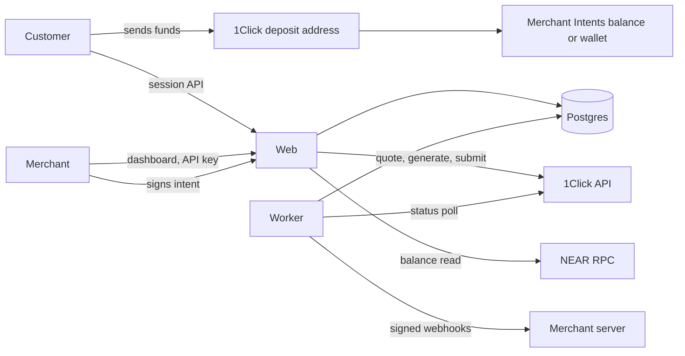

# Gateway production design

Date: 2026-11-06. Status: decisions delegated to the implementer by the project lead ("rest things manage by your own"), except where marked as needing a human.

## Goal

Turn the frontend mock into a real, non-custodial crypto payment gateway: real accounts, real data, real NEAR Intents payments, payouts and refunds, a real widget and API, and every feature the UI shows. Real money is possible but switched off until a person explicitly approves it.

## Decisions

| # | Decision | Why |
| --- | --- | --- |
| 1 | Default settlement goes to the **merchant's own NEAR Intents balance** (`recipientType: INTENTS`, recipient = the merchant's lowercase EVM address). Per merchant, **direct-to-wallet** (`DESTINATION_CHAIN`, EVM receive assets only, always the verified wallet) is the alternative. | Keeps balances, payouts, swaps and refunds. Gateway holds no keys and ships no contract to audit. |
| 2 | Gateway never holds a merchant key. Every balance payout and refund is signed by the merchant's wallet. Scheduled payouts become scheduled prompts. | Each key on an Intents account has full control and no limited key type is documented, so a Gateway-held key would be custody. |
| 3 | Merchants accept responsibility for their own KYC, AML, licences and regulatory audits in the Merchant Terms, with a stored, versioned acceptance. There is no licensing gate in the product. | Lead's decision. Needs a lawyer's read before real merchants; see Human items. |
| 4 | Gateway still screens wallets against sanctions lists, keeps an audit log and shows disclosures. | 1Click terms 4.1(f), (g), (i), (j) and 4.4 bind the developer whatever our merchant terms say; losing the API ends the product. |
| 5 | Product copy says "non-custodial", never "decentralized". | Gateway runs servers and an API key. Only non-custody is provable. |
| 6 | Payments run in `sim` mode unless every live gate passes (see Live gates). Sim mode uses the same pipeline with a simulated provider. | Real tests spend real money, and the docs show no sandbox. |
| 7 | The merchant API exposes payments, links and webhooks, never a quote pass-through. | Terms 4.1(a) bars exposing 1Click as a "standalone API service, proxy, wrapper, or gateway". |
| 9 | Bitcoin stays closed in live mode. | Quotes touching Bitcoin don't verify with NEAR's own SDK, dry or live, in either direction (2026-11-06). That signature is the only proof a deposit address pays the recipient. A live test flags when this changes. |
| 8 | Keep the existing views. Rewire `lib/store.ts` to the server behind the same `useGateway()` and `actions` surface. Money actions are not optimistic. | Least churn; the UI is the part that already works. |

Option rejected: Gateway-held funds (a key theft loses everything, the non-custodial claim goes, payout sweeps may conflict with 4.1(h)). Option deferred: our own vault contracts (largest build, audit needed, EVM only); revisit if merchants demand fully automatic payouts.

## Architecture

- **Web**: Next.js 16 App Router. Route handlers under `app/api`. Proxy (`proxy.ts`) does optimistic redirects only; handlers enforce auth.
- **Worker**: a separate Node process (`worker/index.ts`) for status polling, webhook delivery, email, reconciliation, schedules and list refresh. Jobs are claimed with `FOR UPDATE SKIP LOCKED`, so several workers are safe.
- **Database**: Postgres, Drizzle ORM and committed SQL migrations. Base-unit amounts are `numeric(78,0)`, read as strings and computed with `BigInt`; floats are for display only.
- **Server code** lives in `server/`, each file starting with `import "server-only"` where it may be reached from Next. Client code never imports it.
- **Auth**: passwordless email magic links; opaque session tokens stored hashed; `HttpOnly; Secure; SameSite=Lax` cookies; Origin check on every mutating handler; RBAC (owner, admin, finance, viewer) enforced per handler.
- **Client wallet**: EIP-1193 and EIP-6963 injected wallets with `viem` helpers. No project ID or third-party relay.

## Money flows

### Payment (customer pays)

1. `/pay/[id]` or `/embed/[id]` loads the public source. The customer picks an asset, and the amount if the link lets them.
2. A preview is a `dry` quote. It shows what they pay and the route fee.
3. The customer connects a wallet or enters one. It becomes `refundTo` and satisfies the visible-wallet rule. It is format-checked for that chain and screened.
4. The server inserts the payment row (`quoting`) **before** calling 1Click, keyed by a client idempotency key, then requests a live `EXACT_OUTPUT` quote: the merchant receives the exact amount, and fees raise the deposit.
5. Quote guards run (below). The full quote and signature are stored. The customer sees the address, memo, amount, deadline, and "pay with wallet" on EVM.
6. Optional `POST /v0/deposit/submit` with the tx hash speeds detection.
7. The worker polls `/v0/status` until terminal.

### Payment state machine

`quoting -> awaiting_deposit -> deposit_seen -> processing -> settled`, with `incomplete_deposit`, `provider_refunded`, `failed`, `expired`, `underpaid` (SUCCESS, but less arrived than was quoted), and for merchant refunds `settled -> refund_pending -> refunded`. SUCCESS with no amount isn't settled at all.

- `expired` means the customer's countdown ended with no deposit seen. It is **not final**: polling continues (every 6 hours, for 30 days past the deadline), and any later status moves the payment forward. `PENDING_DEPOSIT` never means "unpaid".
- No flow reissues a deposit address automatically. Starting over is an explicit customer action with an "if you already sent funds, do not send again" warning, and old addresses stay tracked.
- Each transition appends a `payment_events` row and an outbox row in one transaction. Transitions are a pure, tested function of (current state, provider status).
- Provider errors never change state. They back off and raise an alert after repeated failure.

Dashboard mapping: `awaiting_deposit` and `quoting` are not shown as payments. `deposit_seen`, `processing`, `incomplete_deposit` show as `processing`, `settled` and `refund_pending` as `settled`, `refunded` as `refunded`, `expired` as `expired`, `provider_refunded` and `failed` as a new `failed`.

### Balance, hold and availability

Balance is read from `intents.near` `mt_batch_balance_of` for the merchant's account and is the source of truth. `on hold` is the settled receive amount inside the merchant's refund window, `arriving` is in-flight payments, and `available = on-chain balance - on hold - payouts and refunds in flight`, per asset, in `BigInt`. The hold is enforced by Gateway only; the merchant owns the key and can always move funds elsewhere, and the UI says so. There's no separate ledger balance to reconcile, because availability always starts from the chain. A settlement below the quoted amount is logged and audited.

### Payout (merchant withdraws, balance mode only)

1. `POST /api/payouts` (owner or finance): checks availability, destination screening and route controls. Inserts the payout row, gets a live quote with `depositType: INTENTS`, `refundType: INTENTS`, `refundTo` = the merchant account, runs the guards, calls `/v0/generate-intent` with `standard: erc191`, and stores the payload.
2. The client decodes the payload, checks it matches the summary, and asks the wallet to `personal_sign` it.
3. `POST /api/payouts/:id/sign`: recovers the signer from the signature and compares it with the merchant wallet; normalizes `v` to 0 or 1; encodes `secp256k1:<base58 r||s||v>`; calls `/v0/submit-intent`. Attempt is stamped before the send; a second submission is refused.
4. The worker polls by deposit address.

### Refund

- Balance mode: the payout flow with the customer's stored refund address as recipient and their paid asset as destination. Full and partial. The merchant signs.
- Direct mode: a quote from the merchant's wallet to the customer's asset and chain. The merchant sends to its deposit address from their wallet, and the worker tracks it. Asking again returns the same address. An unfunded refund can be replaced after 30 minutes, and stays watched in case money arrives late.
- A refund can't spend from a previous settlement wallet: balances belong to a key.

### Settlement wallet changes

Changing the settlement wallet redirects all future money, so a stolen session must not be able to do it at all. It requires an owner, a signature from the new wallet, and a signature from the current wallet, with no timed fallback an attacker could wait out. The old wallet's balance must be empty and nothing may be in flight to it, because balances belong to a key. Owners are emailed. A merchant who lost their key goes through a manual process; see the operations runbook.

Payout destinations other than the wallet itself need the settlement wallet's signature too. It's checked again before each payout, so it stops being valid if the wallet changes. Because the wallet only ever sees a transfer to a routing address, the browser verifies 1Click's signature, that it's a live quote (a dry quote's signature covers no address), and that recipient, assets, amount and refund address all match what the merchant chose, before asking the wallet to sign. `personal_sign` signs any text, and an Intents account accepts a signed `add_public_key` the same way, so challenges are checked for their exact form too. This protects merchants from a compromised API on the payout path. It proves the provider issued a quote for that recipient, not that the merchant approved the recipient, and nothing helps if the server can change the script it serves. A compromised server could also change `recipient` on new customer quotes, because customers can't verify it. These risks are disclosed in the Known limits.

## Guards

Each guard gets a test, and each is mutation-checked: delete the guard and a test must fail.

| Guard | Behaviour |
| --- | --- |
| Echo | The returned `quoteRequest` must match what we sent on recipient, recipient type, refund, refund type, assets, amount, deposit type and swap type. Our fee must be present, no more than 30 bps may be added, and `amountOut` or `amountIn` must match by swap type. |
| Signature | Verify the 1Click quote signature and timestamp before using a deposit address. |
| Deadline | The provider returns its own deadline, days past what we ask for. The customer's countdown is ours: 30 minutes, 60 for Bitcoin, and always at least 15 (90 for Bitcoin) before the provider's deadline. No safe window, no address. |
| Refund fee | Refuse a route where NEAR's `refundFee` exceeds 5% of the deposit. Checkout discloses the fee. |
| Unverifiable | Bitcoin routes refused in live mode. See decision 9. |
| Minimums | Refuse before quoting when a route is under a known minimum: origin-to-origin $1,000 on bsc, pol, ton, op, avax, stellar, monad, xlayer, adi; $100 on tron. Checks 1Click's own `amountInUsd` too. Applies to Intents recipients until a live canary proves otherwise, and to the receive side in direct mode. |
| Route control | Global mode plus per-chain and per-asset pause in the database. Paused routes refuse new quotes; in-flight payments keep polling. |
| Price sanity | Refuse a quote where the customer would pay, or the merchant receive, over 3% below the price. A wrong price would otherwise under-pay the merchant. |
| Price freshness | Refuse to compute a non-stable receive amount from a price older than 5 minutes. Cache token data for far less than the 24 hours allowed by 4.1(e). |
| Bounds | Min and max USD per payment. Reject amounts that round to zero base units. |
| Screening | Refund, merchant and destination wallets are checked against the sanctions list. A hit refuses with a neutral message and writes an audit entry. |
| Availability | Payout or refund above `available` is refused, in `BigInt`. |
| Signer | Payout signature must recover to the merchant wallet. |
| Single submit | `submit` is compare-and-set on status, and a late response can't move a row back. An unknown outcome stays reserved and resends the same signed intent, because its nonce is single-use. A refused resend proves nothing, since a duplicate of a send that landed gets refused too. Past the signed deadline plus 5 minutes, judged by when the status was read, it counts as failed. FAILED isn't REFUNDED, so any failure stays reserved and watched for a day from when it failed, and the dashboard doesn't offer a retry until then. |
| Replaced refunds | A route refund's address can't be cancelled. If a replaced one is funded after all, its unfunded replacement closes. If both were funded, both are tracked and a person is told. |
| Modes | Rows made in one mode can't be refunded or signed in the other, because test rows stay after go-live. |
| Idempotency | Session creation and API writes are keyed; a repeat returns the first result. |
| Live gates | See below. |

## Live gates

`PAYMENTS_MODE=live` only takes effect when all hold: `ONECLICK_API_KEY` set, `LIVE_PAYMENTS_ACK` equals the exact phrase in `.env.example`, app fee config complete, and `DATABASE_URL` migrated. If any fail, startup logs why and the app stays in sim. Every surface shows the mode; sim is labelled "Test mode" everywhere money appears.

## Data model

`users`, `login_tokens`, `sessions`, `organizations` (business, branding, settlement mode, wallet, payout settings, notification prefs, terms acceptance), `memberships`, `invites`, `wallet_changes`, `payment_links`, `widgets`, `payments`, `payment_events`, `payouts`, `refunds`, `destinations`, `api_keys`, `webhooks`, `webhook_deliveries`, `outbox`, `notifications`, `audit_log`, `route_controls`, `screened_addresses`, `rate_limits`, `idempotency_keys`, `heartbeats`, `sim_swaps`, `sim_balances`.

## Surfaces

- `app/api/auth/*`, `app/api/state`, `app/api/links|widgets|settings|destinations|api-keys|webhooks|team|payouts|refunds|wallet` (session).
- `app/api/checkout/*` (public, rate limited, returns public fields only).
- `app/api/v1/*` (API key, scoped, idempotent).
- `public/widget.js`, `/embed/[id]`, `packages/react` (`@gateway/react`).
- `/login`, `/signup`, `/onboarding`, `/invite/[token]`, `/terms`, `/privacy`, `/docs`, `/status`, `api/health`.
- New UI from the not-built list: notification centre, more keyboard shortcuts, link and widget detail pages, stepped creation, collapsible rail, tax and statement exports.

## Security

CSP and security headers, with `frame-ancestors 'none'` everywhere except `/embed`; webhook SSRF guard (https only, no private ranges, no redirects, DNS checked at send); AES-256-GCM for webhook secrets; API keys and tokens stored as SHA-256 of high-entropy values; Postgres-backed rate limits; structured logs with secrets redacted; no card or KYC data stored.

## Testing

- Unit: money math, state machine, guards, address validation, signature encoding, webhook signing, RBAC matrix.
- Integration: route handlers against real Postgres (`embedded-postgres` locally and in CI), with a fake 1Click server for contract behaviour.
- Contract: opt-in live tests (`LIVE_SMOKE=1`) for `/v0/tokens`, dry quotes and signature verification.
- Signature format: an erc191 payload signed with a throwaway key, checked through `intents.near` `simulate_intents`.
- E2E: Playwright on Chromium and WebKit, sim mode: sign up, create link, pay, see it in the dashboard, webhook received.
- Mutation: delete each money guard and confirm a test dies.
- Review: two disjoint audit rounds on money code, one of them outside-world only.

## Stages

| Stage | Content | Exit test |
| --- | --- | --- |
| 0 Foundations | Extras removed, proprietary licence notice, typecheck script, Vitest, CI, env schema | CI green |
| 1 Platform | Database, auth, orgs and team, store rewired, real links and widgets, shareable `/pay`, deploy files | Link created in one browser opens in another |
| 2 Payments | Provider layer, guards, checkout, poller, balances, payouts, refunds, wallet changes | Full lifecycle passes in sim; guards mutation-checked |
| 3 Integrations | API keys, webhooks, widget and React package, email, notifications, remaining UI, exports | External page embeds the widget and pays in sim; webhook verified |
| 4 Launch readiness | Screening, terms, docs, monitoring, audits, canary runbook | Audit clean; runbook written |

## Human items (cannot be done by code)

See `docs/runbooks/going-live.md` for the full list and the questions for NEAR.

1. **Mainnet approval.** Explicit go from the lead, after a canary with their own small funds.
2. **NEAR partner key**, and written answers on terms 4.1(a), (e), (f), (h), Bitcoin signatures, second deposits and frozen balances.
3. **Canary funds**, to answer what only real money can.
4. **Lawyer's read** of the Merchant Terms, Privacy Policy and the "no licence" position. These are drafts.
5. **Hosting and email accounts**, the production domain, and the real product name.
6. **Licence choice.** The repo has an all-rights-reserved notice until the owner picks one, because a permissive licence can't be taken back.
7. **Publishing** `@gateway/react` needs an npm account that can own the scope, and the social preview upload needs repo admin.

## Known limits

- Merchant wallets are EVM EOAs. Smart-contract wallets cannot produce the ERC-191 signature the verifier expects.
- A compromised Gateway server could point new customer payments at its own address, because a customer's browser has no merchant-signed record to check against. Non-custodial means Gateway never holds funds, not that the operator is trusted for nothing. Direct-to-wallet doesn't change this.
- A deposit that arrives after a wallet change lands in the old wallet, which the merchant still controls.
- A second deposit to a used address is undocumented by NEAR. We watch for one for a month and alert. There's no per-chain indexer of our own.
- `/embed` can only be framed by the widget's `site` when one is set. Without one, any site can frame it. Payments still go to the merchant either way.
- The browser's quote checks prove the provider issued this quote, and that it matches what the merchant chose on screen. They don't prove the destination list the server sent is the merchant's own, which is why the dialog shows the full address and destinations are signed by the wallet. Nothing helps if the server can change the script it serves.
- A refund of a payment that settled before a wallet change has to be signed by the old wallet, because that's where the funds are.
- A compromised server could show an old route refund quote again, within its deadline, whose address has already been used. Quotes signed as intents are age-checked. Route quotes can't be, because the same address is reopened for days on purpose, so this one relies on the deadline and on the merchant seeing the address.
- A send the provider refuses outright is treated as nothing sent. Only a compromised server could hold that signature and try later, and no state here would stop that.
- A payment that arrives short is `underpaid`. The merchant is told, and it can't be refunded from the dashboard, because what to return is a decision for a person with NEAR's answer.
- Merchant metrics stay client-side, capped at the newest 10,000 payments.
- Balance mode exposes merchants to NEAR Intents risk (pause, exploit, compliance hold). Direct mode is the mitigation.
- The hold is advisory on-chain.
- Non-EVM customers pay by copying the address or scanning; only EVM has one-click pay.
